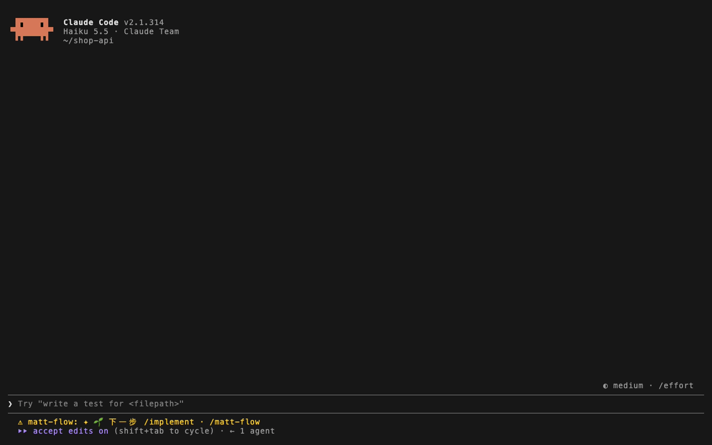
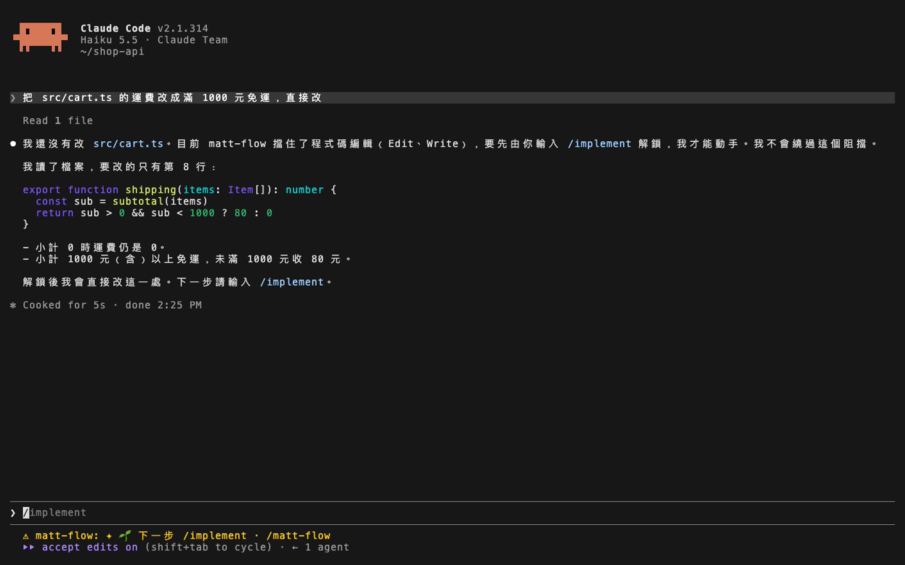
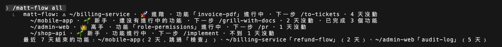
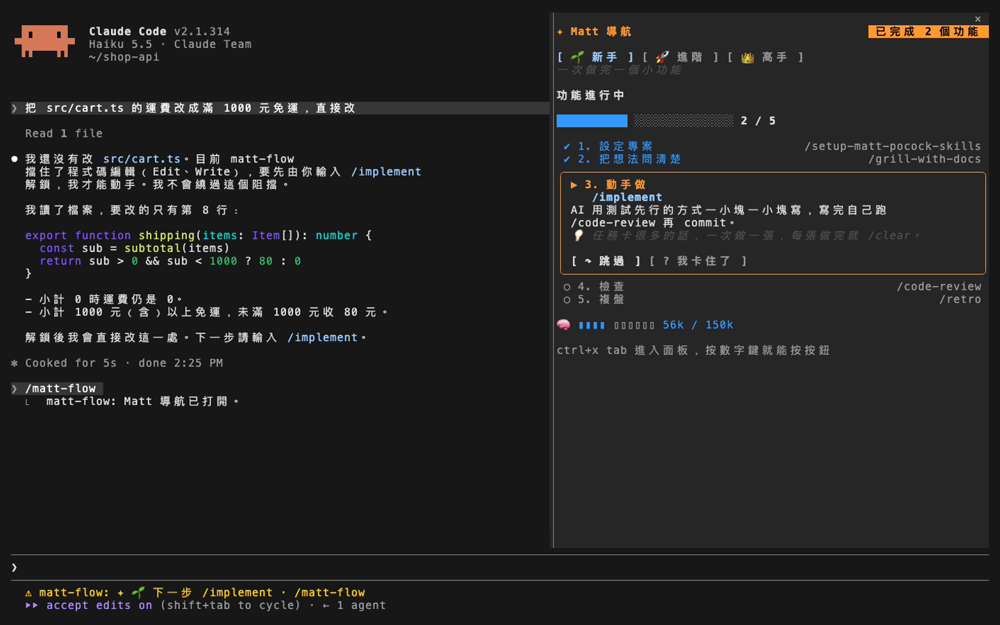
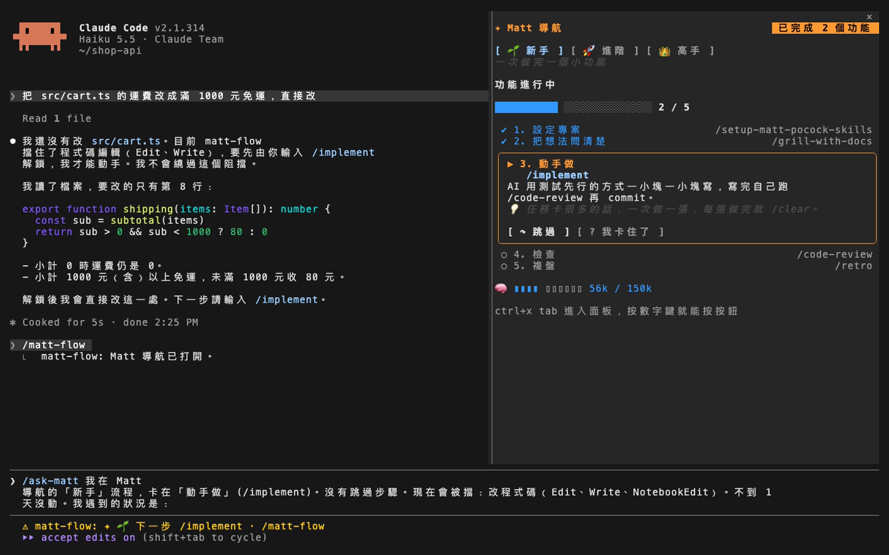
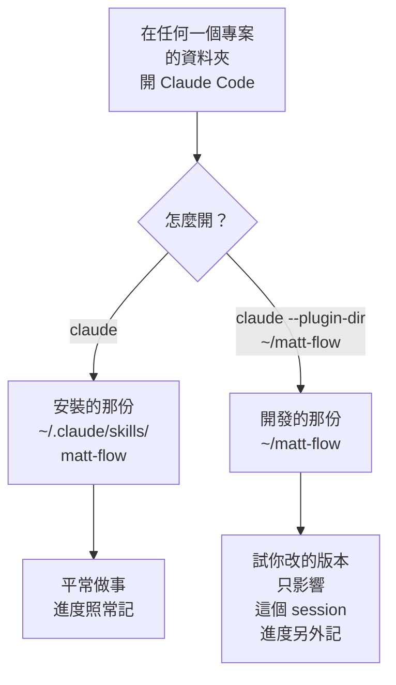
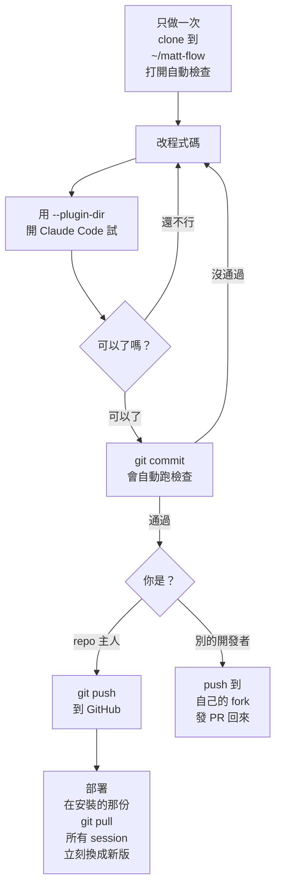

# ✦ matt-flow：Matt 導航

Claude Code 的 mod（一種外掛）。讓 Claude 沿著 [Matt Pocock](https://github.com/mattpocock/skills) 的開發流程走：它知道目前在哪一步，想跳步時會被擋下，每一步結束時把下一步的指令交給你，按 Enter 就繼續。分新手、進階、高手三個等級，旁邊有看進度用的面板，`/matt-flow all` 還能一次看所有專案。

**為什麼要用**：直接用 Claude Code，需求還沒問清楚它就開始改程式，做完也不一定檢查、複盤，流程全靠你自己記。Matt Pocock 把一套開發流程寫成了 skill：先追問到需求清楚，再寫測試和程式，接著檢查，最後複盤、改進下一次的環境。matt-flow 不加新的 skill，只讓你和 Claude 照這套流程的順序走。

**適合誰**：自己用 Claude Code 做功能的人。它是給自己的護欄，不是權限控管：總覽只看得到你這台電腦上的專案，你也隨時可以跳過步驟或關掉它。想看流程會產出什麼，[.scratch/rail/](.scratch/rail/) 是做 0.3 版時留下的規格書和任務卡。



_示範：叫 Claude 直接改程式碼，它停手並把 `/implement` 填進輸入框；接著打開面板、按「我卡住了」、看所有專案。示範在一個暫時建立的專案裡錄製，總覽裡的其他專案是示範資料。_

第一次用：先照下面的「前置條件」和「安裝 matt-flow」裝好，再照 [從零開一個新專案](docs/new-project.md) 一步一步做。

## ⚠️ 前置條件

**Claude Code 要夠新**：matt-flow 用到 Claude Code 新的 mod 功能，作者用的是 2.1.312 以後的版本。用 `claude --version` 看版本，太舊就先執行 `claude update`。目前只在 macOS 上用過，Windows 建議在 WSL 裡用。

**先安裝 mattpocock-skills**：matt-flow 只是導航，本身不包含任何 skill。面板叫你執行的 `/grill-with-docs`、`/to-spec`、`/implement` 等指令，全部來自 `mattpocock-skills` 這個 plugin。沒有先裝的話，面板還是打得開，但它叫你跑的指令都無法執行。

在**個人層級**或**專案層級**擇一安裝：

```bash
# 個人層級：這台電腦上所有專案都能用（建議）
claude plugin install mattpocock-skills@claude-plugins-official

# 專案層級：只有這個專案能用，在專案根目錄執行
claude plugin install mattpocock-skills@claude-plugins-official --scope project
```

也可以在 Claude Code 的提示列輸入 `/plugin install mattpocock-skills@claude-plugins-official`，再選範圍。

`mattpocock-skills` 收錄在 Anthropic 官方的 marketplace（`anthropics/claude-plugins-official`）。安裝時如果出現找不到 marketplace 的錯誤，先加入這個 marketplace，再重新安裝：

```bash
claude plugin marketplace add anthropics/claude-plugins-official
```

安裝時會自動把檔案下載到 `~/.claude/plugins/cache/claude-plugins-official/mattpocock-skills/<版本>/`，啟用設定則寫進 settings：個人層級寫在 `~/.claude/settings.json`，專案層級寫在專案的 `.claude/settings.json`。**不要自己把檔案複製進 `cache` 資料夾**，沒有經過安裝登記的 plugin 不會被啟用。

確認是否裝好：

```bash
claude plugin list
```

看到下面這樣就代表可以用了：

```
❯ mattpocock-skills@claude-plugins-official
  Version: 1.3.1
  Scope: user
  Status: ✔ enabled
```

## 安裝 matt-flow

下面兩種方法擇一就好。兩種都裝的話，mod 會被載入兩次。

### 方法一：用 plugin 指令安裝（建議）

在 Claude Code 的提示列輸入：

```
/plugin install matt-flow --marketplace kevin801221/matt-flow-mods
```

出現 `Add marketplace?` 時按 `y`，接著選安裝範圍（預設是個人層級，直接按 Enter）。

從 shell 安裝：

```bash
claude plugin install matt-flow --marketplace kevin801221/matt-flow-mods
```

桌面版 App 不能用 `/plugin`：點提示框旁邊的 + → Plugins → Add marketplace，輸入 `kevin801221/matt-flow-mods`，再按 Add plugin。

### 方法二：下載到 skills 資料夾

放在 skills 資料夾裡的 mod，Claude Code 會自動載入，而且一存檔就套用到所有開著的 session。所以這個資料夾只拿來安裝，不要在裡面改程式碼（要改的話見最後的「開發」）：

```bash
# 個人層級
git clone https://github.com/kevin801221/matt-flow-mods ~/.claude/skills/matt-flow

# 專案層級（在專案根目錄執行）
git clone https://github.com/kevin801221/matt-flow-mods .claude/skills/matt-flow
```

下載好之後，開一個新的 Claude Code session 就會生效。專案層級的話，把 `.claude/skills/matt-flow/` 加進專案的 `.gitignore`，不然 git 會把它當成另一個 repo 一起加進去。

### 更新、停用、移除

| | 方法一（plugin 指令） | 方法二（skills 資料夾） |
| --- | --- | --- |
| 更新 | `claude plugin update matt-flow@matt-flow`，再重開 Claude Code | `git -C ~/.claude/skills/matt-flow pull` |
| 暫時停用 | `claude plugin disable matt-flow@matt-flow`，用 `enable` 打開 | 把資料夾移出 `~/.claude/skills/` |
| 移除 | `claude plugin uninstall matt-flow@matt-flow` | 刪掉 `~/.claude/skills/matt-flow` |

只想在某個專案關掉，用 `/matt-flow off`（見「跳過、結束、關掉」）。matt-flow 自己出錯、每個專案都改不了程式碼時，照上表停用它。

## 使用方式

matt-flow 是一條軌道：它記得每個專案走到流程的哪一步，把這件事附在你的輸入旁邊告訴 Claude，在步驟還沒通過時擋下 Claude 的動作，並在每一步結束時把下一步的指令交給你。指令一律由你輸入，matt-flow 自己不會執行任何步驟。

### 已知問題

- **`/clear` 之後 matt-flow 會失效（修正中）**：在同一個 session 裡打了 `/clear`，matt-flow 會忘記這個專案，不再擋也不再提示，面板也會說這個專案還沒設定。面板或提示叫你 `/clear` 時，先改成輸入 `/exit` 離開，再重新打 `claude`。
- Claude 改用 Bash 寫檔不會被程式擋下，只靠擋下訊息和軌道禁止。

### 等級

| 等級 | 流程 |
| --- | --- |
| 🌱 新手 | `/setup-matt-pocock-skills` → `/grill-with-docs` → `/implement` → `/code-review` → `/retro` |
| 🚀 進階 | `/setup-matt-pocock-skills` → `/grill-with-docs` → `/to-spec` → `/to-tickets` → `/implement` → `/retro` |
| 👑 高手 | `/setup-matt-pocock-skills` → `/grill-with-docs` → `/to-spec` → `/to-tickets` → `/implement-spec` → `/pr` → `/retro` |

等級在面板上隨時可以換。第一步一定是 `/setup-matt-pocock-skills`，每個專案只要做一次：它會建立 `docs/agents/issue-tracker.md`，偵測到這個檔案就算通過。**沒做過 setup 的專案，軌道完全安靜**：不擋、不提示，也不附流程說明。

在專案的子資料夾開 session，算同一個專案：從那裡往上找，最近一個有 `docs/agents/issue-tracker.md` 的資料夾就是專案。每個 linked worktree 有自己的 checkout，各算一個專案，所以想同時做兩個功能，就開一個 worktree。

### 功能和通過

- **你**輸入任何一個流程步驟的指令（setup 除外），就開始一個**功能**。Claude 透過 Skill 工具跑的 skill 不會開始功能，例如 `/triage` 背後跑的 grilling。
- 有產出物的步驟看產出物。用本地 markdown tracker 時，「寫成規格書」要等 `.scratch/<功能>/spec.md` 寫出來，「切成任務卡」要等同一個資料夾的 `issues/` 裡至少有一張卡，只輸入 `/to-spec` 不算；產出物在 Claude 每次回覆完時檢查，規格寫出來後，功能就用它的資料夾名稱稱呼。用 GitHub 或 GitLab tracker 時，skill 跑過就算。
- 「動手做」只在**你**輸入 `/implement`（高手是 `/implement-spec`）時通過。Claude 自己跑 `tdd` 不算，所以它沒辦法自己越過交棒。
- 其他步驟（問清楚、檢查、開 PR、複盤）skill 跑過就算：你輸入的，或功能進行中 Claude 在主線透過 Skill 工具跑的都可以。分身（subagent）跑的不算。
- 「複盤」通過，功能就結束，已完成的功能數加一。接著是**收尾**：程式碼保持解鎖，讓你落實複盤建議的環境修改，直到你輸入 `/matt-flow end` 或開始下一個功能。下一個功能從 `/grill-with-docs` 開始。

### 交棒

步驟通過時會跳出提示，Claude 這次回覆完時，下一步的指令會預填在輸入框，按 Enter 就啟動。

- 要來回好幾個回合的步驟（問清楚、切成任務卡、並行開發）一開始就算通過，但要等做完才交棒：提示寫明怎樣算做完（問題問完、任務卡切好、分身都合併）和之後的指令，不預填。
- 進階等級每做完一張任務卡，提示會同時列出兩條路：還有卡就 `/clear` 後 `/implement` 下一張（`/clear` 修好之前，見「已知問題」），都做好了再 `/retro`。

流程說明附在你的輸入旁邊給 Claude，寫著目前的功能、等級、下一步、哪些動作會被擋、怎麼解鎖、還能做什麼，以及交棒的規矩：你啟動的 skill 整個做完才停下來，把下一步的指令告訴你；除了下一步的指令和 `/matt-flow`，不主動建議流程指令；沒有進行中的功能、或你問該怎麼辦時，可以點名 Matt 的入口（`/triage`、`/diagnosing-bugs`、`/wayfinder`、`/improve-codebase-architecture`、`/to-questionnaire`），一樣由你輸入；你輸入 `/ask-matt` 時照常回答；絕不繞過阻擋。說明只在內容變了，或它已經不在對話裡（壓縮、倒帶之後）才重送，不會每次輸入都附一份。

### 程式碼關卡

在動手做通過之前，Claude 對**程式碼**的 Edit、Write、NotebookEdit 都會被擋下。擋下訊息寫明下一步和解鎖用的指令（沒有進行中的功能時是 `/grill-with-docs`，否則是下一步的指令），要 Claude 停下來交棒，同一個指令也會預填進輸入框。



markdown 檔、`docs/`、`.scratch/` 和專案外的檔案不算程式碼，所以思考類的步驟照樣能寫詞彙表、ADR、規格和任務卡。

關卡自己出錯時（例如更新後壞了），照樣擋程式碼和 `git commit`，其他動作不受影響。擋下訊息會說怎麼退回上一版（方法二）；用方法一安裝的，照「更新、停用、移除」先停用它。

### commit 關卡

新手和進階：每次你輸入 `/implement` 之後，要先跑過一次 code-review（你輸入 `/code-review`，或 Claude 透過 Skill 工具執行，例如 `/implement` 自己跑的那次），Claude 的 `git commit` 才會放行；review 之後的修正不用再 review 一次。被擋下時，`/code-review` 會預填在輸入框。動手做以外的 commit 一律放行，那時候 Claude 改得到的只有文件。高手不擋，`/implement-spec` 最後一步自己會 review。在新手或進階等級輸入 `/implement-spec` 時，它的分身（subagent）可以 commit 自己的任務卡，主線照樣要先 review。

### 跳過、結束、關掉

| 指令 | 作用 |
| --- | --- |
| `/matt-flow` | 打開或關閉面板 |
| `/matt-flow all` | 總覽：所有專案停在哪一步、幾天沒動，以及最近 7 天結束的功能 |
| `/matt-flow skip` | 把下一步記為跳過，流程往後走一步；跳過複盤會結束功能 |
| `/matt-flow end` | 結束目前的功能，或結束複盤後的收尾 |
| `/matt-flow off` | 在這個專案關掉軌道：不擋程式碼和 commit，不交棒，也不附流程說明 |
| `/matt-flow on` | 在這個專案重新打開軌道 |

每個參數都會回一行訊息，說明改了什麼、下一步是什麼。你也可以直接輸入後面步驟的指令：指令照常執行，前面還沒通過的步驟會記為跳過，提示會列出它們。例外是動手做之前輸入 `/code-review`、`/pr`、`/retro`：skill 照樣執行，但流程不動，不會跳過動手做；想在動手做之前結束功能，用 `/matt-flow end`。**你輸入的指令永遠不會被擋。**

動手做途中換等級時，新等級裡到它的動手做為止還沒通過的步驟都記為跳過，流程從動手做之後接著走。

### 總覽

`/matt-flow all` 每個專案列一行：等級、功能、下一步、幾天沒動；沒有進行中的功能時，再加上已完成幾個功能。「沒動」指流程沒有往前：沒有步驟通過或跳過、沒有功能開始或結束，也沒有再輸入 `/implement` 或跑 code-review；換等級、開關軌道都不算。功能進行中、超過 3 天沒動的那一行前面加 ⚠，最久沒動的排最前面。最後一行列出最近 7 天結束的功能，以及各花了幾天、跳過了哪些步驟。



沒有進行中的功能、也沒完成過功能的專案不會列出來。總覽只看得到這台電腦上、你這個使用者的專案。

### 面板

面板用來看進度：等級按鈕、目前的功能、每個步驟的狀態（✔ 通過、↷ 跳過）、下一步的卡片、對話用掉多少 context，以及已完成的功能數。卡片上有兩個按鈕：`↷ 跳過`（跟 `/matt-flow skip` 一樣）和 `? 我卡住了`（把 `/ask-matt` 插進輸入框，附上你卡在哪一步、跳過了哪些步驟、現在什麼會被擋、幾天沒動；你打到一半的字會留著）。在終端機裡要先按 `ctrl+x tab` 進入面板，再按 `1`（跳過）或 `2`（我卡住了）。





狀態列會一直顯示下一步的指令，不用打開面板也看得到。

升級前存的進度會延續下來：0.2 版已完成的步驟算通過，做過的輪數算已完成的功能。0.5 版以前存的進度沒記下流程上次往前的時間，下次往前之前，總覽先用功能開始的時間代替；功能紀錄從 0.5 版開始留。

## 開發

你的電腦上會有兩份 matt-flow：

- **安裝的那份**：`~/.claude/skills/matt-flow`。每個專案都會自動載入，平常做事用的就是它。不要在裡面改程式碼，它一存檔就會套用到所有開著的 session。
- **開發的那份**：另外 clone 的 `~/matt-flow`。程式碼都在這裡改。

開 Claude Code 的方式決定這次用哪一份：



開發的那份只要 clone 一次，所有專案共用：在哪個專案的資料夾打 `claude --plugin-dir ~/matt-flow`，試的就是哪個專案，安裝的那份這次不會跑。兩份的進度分開記，開發的那份看不到你平常的進度，所以只拿來試，正式做事用安裝的那份。

整個開發流程：



第一次的設定：

```bash
git clone https://github.com/kevin801221/matt-flow-mods ~/matt-flow
cd ~/matt-flow
git config core.hooksPath .githooks
claude plugin validate .
claude plugin test .
scripts/typecheck
```

`git config core.hooksPath .githooks` 每個 clone 執行一次：之後每次 commit 前都會自動跑 validate、測試和型別檢查，沒通過就不能 commit，你和 Claude 都一樣。型別檢查要先裝 Node.js（用 `npx` 跑 TypeScript），還要用到 Claude Code 的型別檔：它只在某個 session 載入過 plugin-authoring skill 之後才會出現，找不到時 `scripts/typecheck` 會說明並略過。

這個 repo 自己也用 matt-flow 管開發，所以在 clone 裡第一次叫 Claude 改程式碼會被擋下。這是正常的，照擋下訊息從流程的第一步開始就好。別的開發者沒有這個 repo 的 push 權限：先 fork，clone 自己的 fork 來改，最後發 PR 回來。

部署：先 push，再讓 skills 資料夾從 GitHub 拉新版，所有開著的 session 會立刻換成新版。先 push 是為了讓 GitHub 上一直有一份備份，不會只剩你電腦上那一份。部署前也可以先備份進度，也就是 `~/.claude/plugins/store/` 底下 `matt-flow_` 開頭的 JSON 檔。

```bash
git -C ~/matt-flow push origin main
git -C ~/.claude/skills/matt-flow pull --ff-only
```

部署之後，確認新版真的載入了、hook 沒有被其他外掛跳過。排在 matt-flow 前面的外掛，測試看不到，只有真的跑一次才知道（會花一次很小的 Haiku 呼叫）：

```bash
cd /tmp && claude -p --debug --debug-file /tmp/matt-flow.log --model claude-haiku-5-5 "Reply with just: ok"
grep -E 'matt-flow@[^ ]* loaded|\] matt-flow: ' /tmp/matt-flow.log
```

應該只看到一行 `loaded`；其他每一行都是引擎回報的問題，例如 `bypassed by` 就是那個 hook 被排在前面的外掛跳過、沒在跑。想知道引擎其他的實際行為（例如外掛讀得到哪些對話內容），也可以照這個做法，用一個臨時外掛跑 `claude -p --plugin-dir <資料夾>`。

部署壞了就退回上一版：

```bash
git -C ~/.claude/skills/matt-flow reset --hard 'HEAD@{1}'
```

## 授權

MIT，見 [LICENSE](LICENSE)。這是個人做的非官方專案，跟 Matt Pocock 本人沒有關係；流程和所有 skill 都來自 [mattpocock/skills](https://github.com/mattpocock/skills)。
