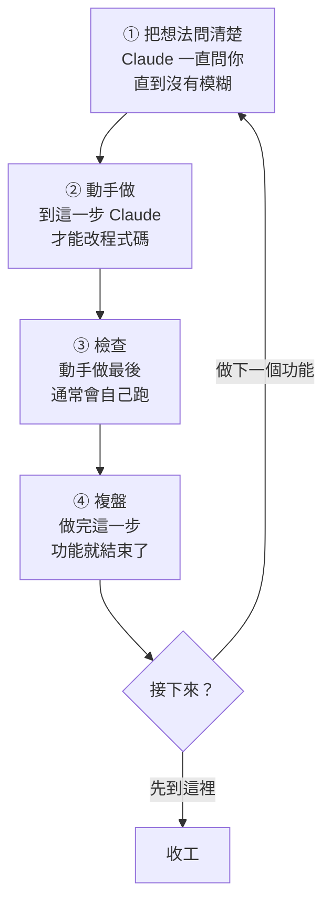

# 從零開一個新專案

從一個空資料夾開始，用 matt-flow 做完第一個功能。照順序做，每一步都只有一兩行指令。已經有專案的話，先看最後的「在現有的專案試用」。

## 1. 確認兩個 plugin 都裝好了

每台電腦只要裝一次。在終端機輸入：

```bash
claude plugin list
```

要看到這兩個：

```
❯ mattpocock-skills@claude-plugins-official
    Status: ✔ enabled
❯ matt-flow@skills-dir
    Status: ✔ loaded
```

用 `/plugin install` 裝的 matt-flow 會顯示成 `matt-flow@matt-flow`，一樣可以用。少了哪一個，就照 [README](../README.md) 的「前置條件」或「安裝 matt-flow」裝好。

## 2. 建專案資料夾

```bash
mkdir ~/my-app
cd ~/my-app
git init
git commit --allow-empty -m "init"
```

`my-app` 換成你的專案名稱。最後一行先建一個空的 commit，之後「檢查」時 Claude 才有起點可以比對。

## 3. 開 Claude Code

```bash
claude
```

第一次在這個資料夾開，它會問你信不信任這個資料夾，選信任（Yes）。

這時 matt-flow 還不會出聲：沒設定過的專案，它不擋也不提示。

## 4. 設定專案（每個專案一次）

在 Claude Code 裡輸入：

```
/setup-matt-pocock-skills
```

它會問你幾個問題，每題都會先給建議答案：

- **要建 CLAUDE.md 還是 AGENTS.md**：選 `CLAUDE.md`，Claude Code 每次都會讀它。
- **任務卡放在哪裡（issue tracker）**：一個人做、還沒有 GitHub repo，就選「Local markdown」，任務卡會存成專案裡 `.scratch/` 的檔案。
- **其他問題**：照它的建議答就好。

設定完會多出 `docs/agents/` 資料夾。matt-flow 看到裡面的 `issue-tracker.md`，就開始管這個專案，狀態列會出現下一步的指令。

## 5. 做第一個功能

新專案一開始是 🌱 新手等級，一個功能這樣走：



| 步驟 | 指令 |
| --- | --- |
| ① 把想法問清楚 | `/grill-with-docs` |
| ② 動手做 | `/implement` |
| ③ 檢查 | `/code-review`（`/implement` 最後通常會自己跑，跑過就算） |
| ④ 複盤 | `/retro` |
| 收工 | `/matt-flow end` |

在指令後面直接寫你的想法，例如 `/grill-with-docs 我想做一個讓同事登記請假的頁面`。

只要記得一件事：**Claude 說這一步做完、告訴你下一步時，下一步的指令會填在輸入框，按 Enter 就繼續。** 忘了做到哪，看狀態列。兩個例外：

- 「把想法問清楚」問完不會自動填，自己輸入 `/implement`。
- Claude 還在問你問題時，輸入框裡可能已經填了下一步的指令，例如 `/implement` 一開始會先問你要測哪些地方。先把輸入框裡的指令刪掉，直接回答；這一步真的做完後，再照狀態列輸入下一步。

在「動手做」之前叫 Claude 改程式碼，會被擋下來。這是正常的：matt-flow 要你先把想法問清楚再寫程式。Claude 會停下來，把該打的指令填進輸入框，照著按 Enter 就好。

## 常用指令

| 指令 | 作用 |
| --- | --- |
| `/matt-flow` | 打開或關閉面板：看進度、換等級 |
| `/matt-flow all` | 看所有專案各停在哪一步 |
| `/matt-flow skip` | 跳過下一步 |
| `/matt-flow end` | 結束目前的功能 |
| `/matt-flow off` | 在這個專案關掉 matt-flow，`/matt-flow on` 再打開 |

卡住的時候，打開面板按「? 我卡住了」（終端機裡先按 `ctrl+x tab`，再按 `2`）。它會把你卡在哪一步整理好，填進輸入框，用 `/ask-matt` 問。

很小的改動（例如改一行字）不用從頭問：直接輸入 `/implement 把按鈕改成藍色`，前面的「把想法問清楚」會記為跳過。這個專案完全不想被管，就輸入 `/matt-flow off`。

進度存在這台電腦上，關掉 Claude Code 也不會不見。熟了以後，可以在面板換成 🚀 進階或 👑 高手，差別見 README 的「等級」。

## 在現有的專案試用

已經有專案的話，跳過第 2 步：在專案的根目錄打 `claude`，從第 3 步開始。設定之前先知道三件事：

- 先開一個新的分支再設定，不喜歡就整個丟掉。
- 設定會新增 `docs/agents/`，也會改專案的 `CLAUDE.md`（沒有的話會問你要不要建）。專案連著 GitHub 時，它會建議把任務卡放在 GitHub Issues，還可能在那個 repo 建 label；只是試用的話選「Local markdown」，就不會動到 GitHub。
- 設定完，Claude 改程式碼就會被擋，要等某個功能走到「動手做」。臨時要改別的，用 `/matt-flow off`，改完再 `/matt-flow on`。

## ⚠️ 目前已知的問題

**`/clear` 之後 matt-flow 會失效（修正中）。** 在同一個 session 裡打了 `/clear`，matt-flow 會忘記這個專案，不再擋也不再提示。面板上「每張做完就 /clear」這類提示，修好之前也先別照做。想清空對話，先輸入 `/exit` 離開，再重新打 `claude`。

新手等級在「把想法問清楚」和「動手做」之間不要清空對話：動手做靠的就是前面問清楚的內容。
